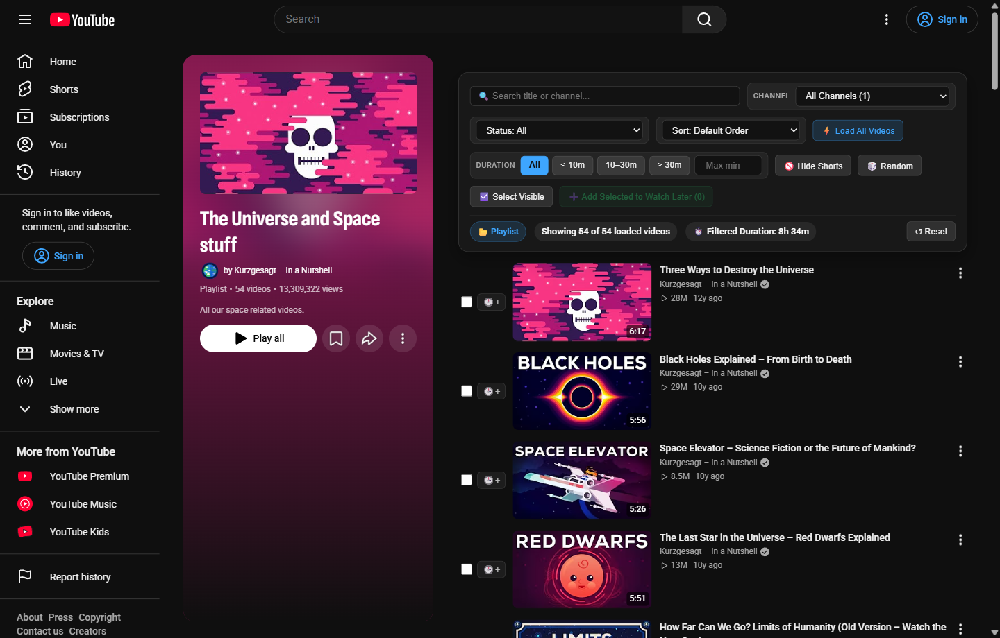
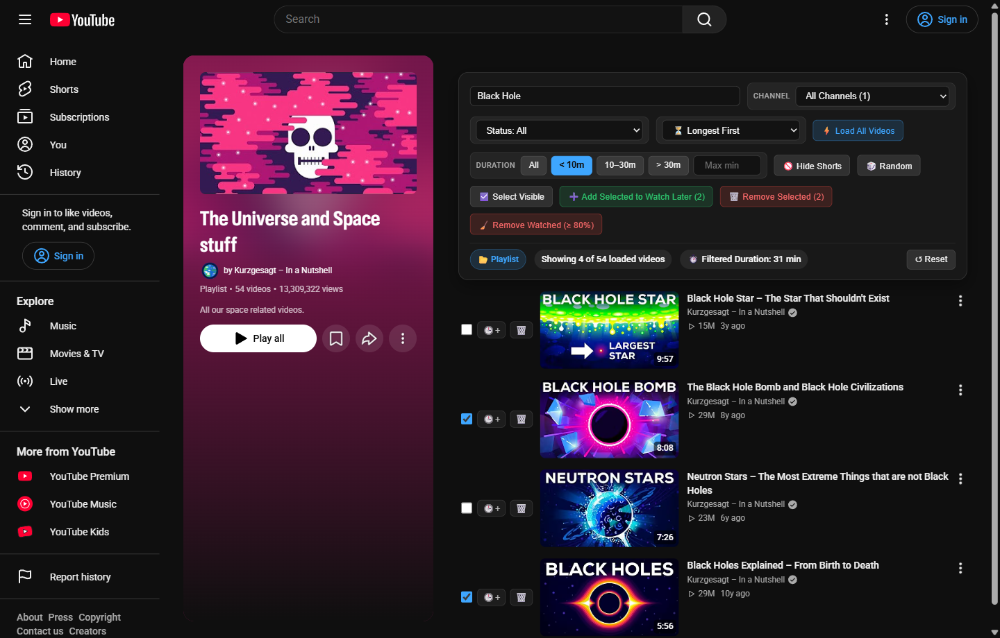
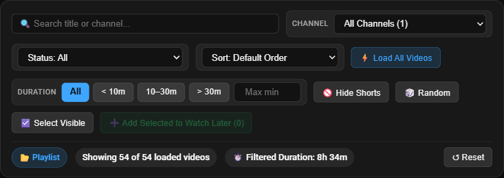

#  Watch Later & Playlist Manager for YouTube

A fast, modern filter, sort, auto-load, and bulk-management bar for **YouTube Watch Later (`WL`)**, **Liked Videos (`LL`)**, and **all custom or public playlists (`PL...`)**.

Works both as a **Tampermonkey / Violentmonkey Userscript** and as a standalone **Firefox Add-on (WebExtension)** — running 100% locally in your browser with zero tracking, zero external dependencies, and full compatibility with YouTube's strict `TrustedHTML` Content Security Policy (CSP).



---

## Features

- **Live Text Search:** Instantly filter loaded videos by **video title** or **channel name** (case-insensitive).
- **Dynamic Channel Quick-Filter:** Auto-populated `<select>` dropdown listing all channels present in the playlist (alphabetically sorted with video counts).
- **Duration Filter & Shorts Blocker:**
  - Quick-select buttons (`All`, `< 10m`, `10–30m`, `> 30m`) + custom `Max min` input.
  - **Hide Shorts** 1-click toggle button.
- **Watch Status Filter:** Filter by `Unwatched (0%)`, `In Progress (1–79%)`, `Almost Done / Watched (≥ 80%)`, `Completed (100%)`, or `Any Started (> 0%)`.
- **Non-Destructive Sorting (CSS Flexbox `order`):**
  - Sort videos by `Default Order`, `Shortest First`, `Longest First`, `Most Watched First (%)`, `Channel (A–Z)`, `Title (A–Z)`, or `Reverse Order`.
  - Because DOM nodes are never detached or re-parented, YouTube's internal Polymer & Wiz event listeners and infinite scroll remain 100% intact.
- **Auto-Loader ("Load All Videos"):** Automatically scrolls through large playlists (> 100 videos) until every item is loaded into the DOM, then smoothly scrolls back to the top.
- **1-Click & Bulk Management:**
  - **Checkbox Selection** (`Select Visible`) for filtered results.
  - **Add Selected to Watch Later:** Copy selected videos from any playlist or *Liked Videos* directly to your *Watch Later* queue in bulk (or individually via the inline Watch Later button).
  - **Remove Selected** & **Remove Watched (≥ 80%)** directly synced with YouTube.
- **Dual-Architecture Support (Polymer & Wiz View-Model):** Seamlessly supports both YouTube's classic `ytd-playlist-video-renderer` playlists and the newer `yt-lockup-view-model` architecture used on *Liked Videos (`list=LL`)* and public playlists.

### Active Filtering, Sorting & Multi-Selection



### Control Bar Close-Up



---

## Installation

### Option A: As a Userscript (Tampermonkey / Violentmonkey – All Browsers)

1. Install [Tampermonkey](https://www.tampermonkey.net/) or [Violentmonkey](https://violentmonkey.github.io/) for Firefox, Chrome, Edge, or Brave.
2. **[Click here for 1-Click Install (`youtube_watch_later_manager.user.js`)](https://raw.githubusercontent.com/smiei/youtube-watchlater-manager/main/youtube_watch_later_manager.user.js)** (or open [`youtube_watch_later_manager.user.js`](youtube_watch_later_manager.user.js) and click **`Raw`**).
3. Tampermonkey will automatically detect the `.user.js` file and open the **Install** prompt.
4. Open any YouTube playlist (e.g. [Watch Later](https://www.youtube.com/playlist?list=WL) or [Liked Videos](https://www.youtube.com/playlist?list=LL)).

### Option B: As a Native Firefox Add-on (No Tampermonkey Required)

This repository includes a ready-to-use Manifest V3 WebExtension configuration ([`manifest.json`](manifest.json)) with localized store metadata (`_locales/en` and `_locales/de`).

1. **Load Temporarily in Firefox:**
   - Open `about:debugging#/runtime/this-firefox` in Firefox.
   - Click **"Load Temporary Add-on…"**
   - Select [`manifest.json`](manifest.json) (or `dist/watch-later-playlist-manager-firefox.zip`).
2. **Build the Release Package (`dist/watch-later-playlist-manager-firefox.zip`):**
   ```powershell
   .\build-firefox-addon.ps1
   ```

---

## License & Disclaimer

Released under the **[MIT License](LICENSE)**.

> **Disclaimer:** This project is an independent open-source tool and is not affiliated with, endorsed by, or sponsored by YouTube or Google LLC. All trademarks belong to their respective owners.
